# Shell-Ejecting Soft-Dart Toy Blaster

This is an original, 3D-printable **toy** blaster with a spring-and-plunger air system.

- **Rack** the slide back and forward. The empty shell flips out to the right and the next shell loads
  from the magazine.
- **Pull** the trigger. A puff of air launches a soft-tip foam dart.

The design is fully parametric: one FreeCAD macro builds every part, checks the mechanism and exports
print-ready STLs.

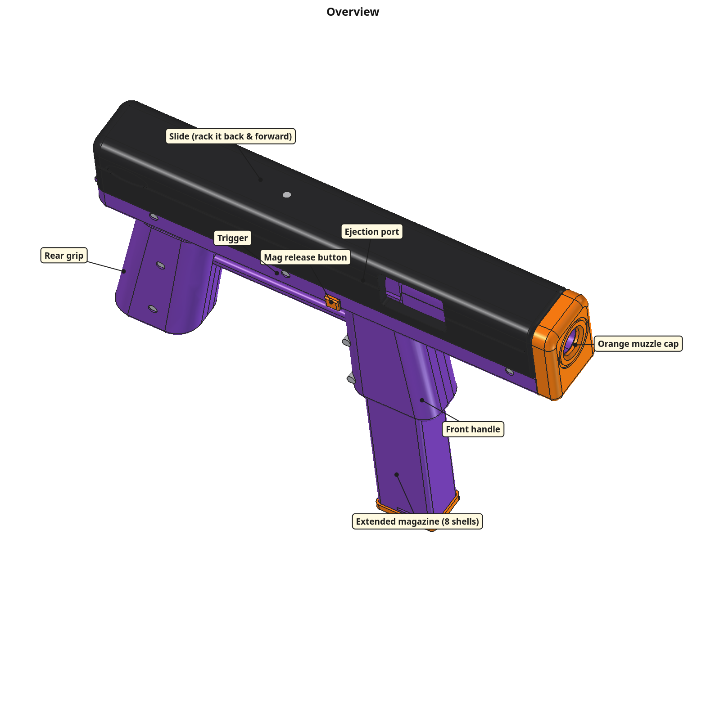

> ### Safety first
> - **Soft-tip dart refills only.** Never print or fire hard projectiles.
> - Keep the main spring **light** (indoor-safe). Never fit a stronger spring than listed.
> - The **orange muzzle cap stays orange** and stays on. Don't paint it or leave it off.
> - Never aim at faces, eyes or animals.

---

## Contents
0. [Visual tour](#0-visual-tour)
1. [What's in this folder](#1-whats-in-this-folder)
2. [How it works](#2-how-it-works)
3. [Before you print: measure your darts](#3-before-you-print-measure-your-darts)
4. [Print in stages (don't waste filament)](#4-print-in-stages-dont-waste-filament)
5. [Print settings](#5-print-settings)
6. [Parts list (printed)](#6-parts-list-printed)
7. [Hardware list (bought)](#7-hardware-list-bought)
8. [Cleaning up the prints](#8-cleaning-up-the-prints)
9. [Assembly](#9-assembly)
10. [Using it](#10-using-it)
11. [Tuning and troubleshooting](#11-tuning-and-troubleshooting)
12. [Changing the design and re-exporting](#12-changing-the-design-and-re-exporting)
13. [What the built-in simulations check (and what they don't)](#13-what-the-built-in-simulations-check-and-what-they-dont)

---

## 0. Visual tour

All pictures are rendered straight from the CAD model by `tools/make_manual_images.py`. Re-run it after
changing the design (see [section 12](#12-changing-the-design-and-re-exporting)).

| Right side | Left side |
|---|---|
| 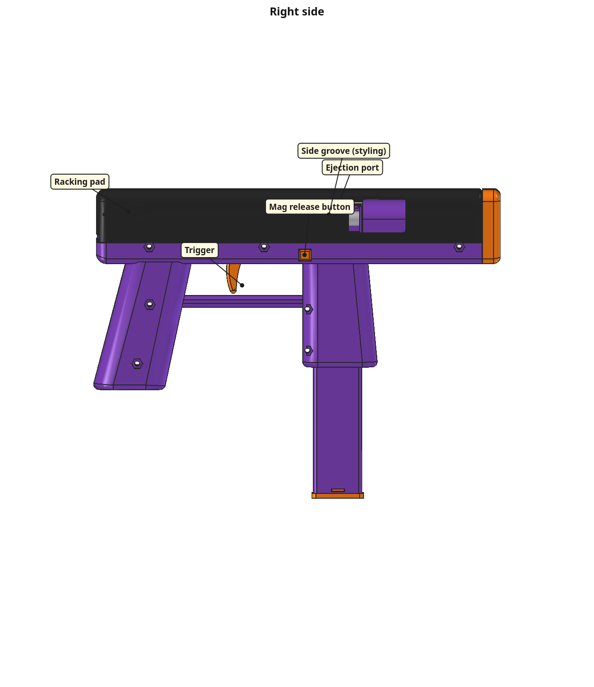 | 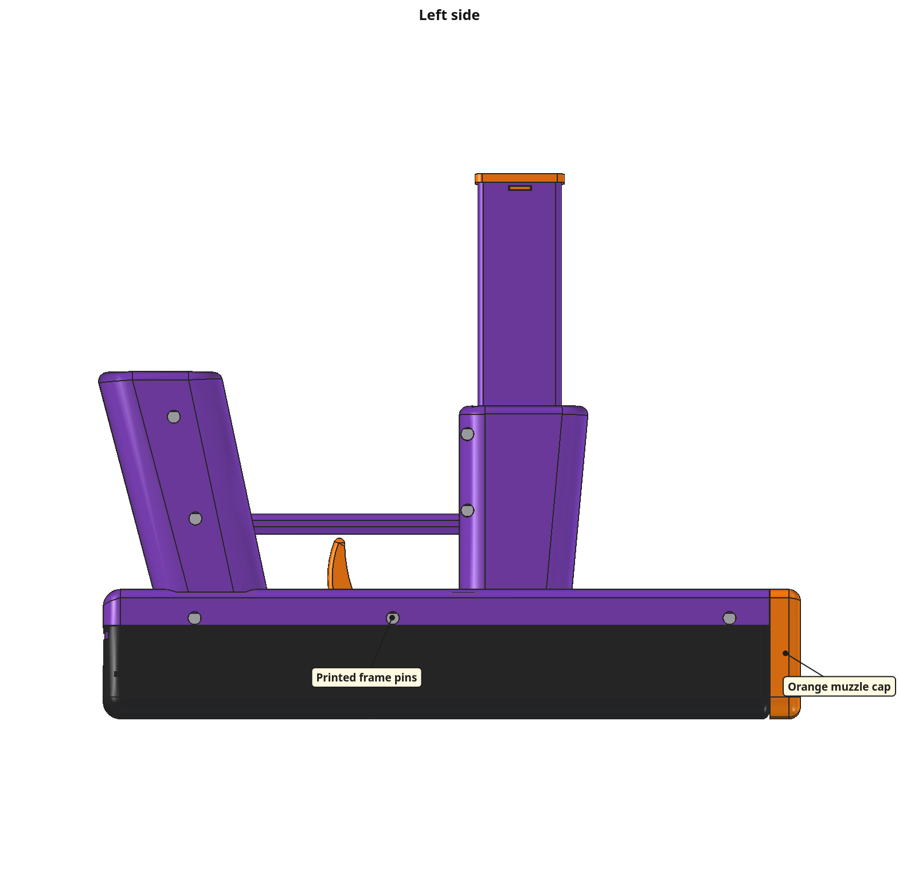 |

**Exploded view:** the main parts you print and how they stack together.

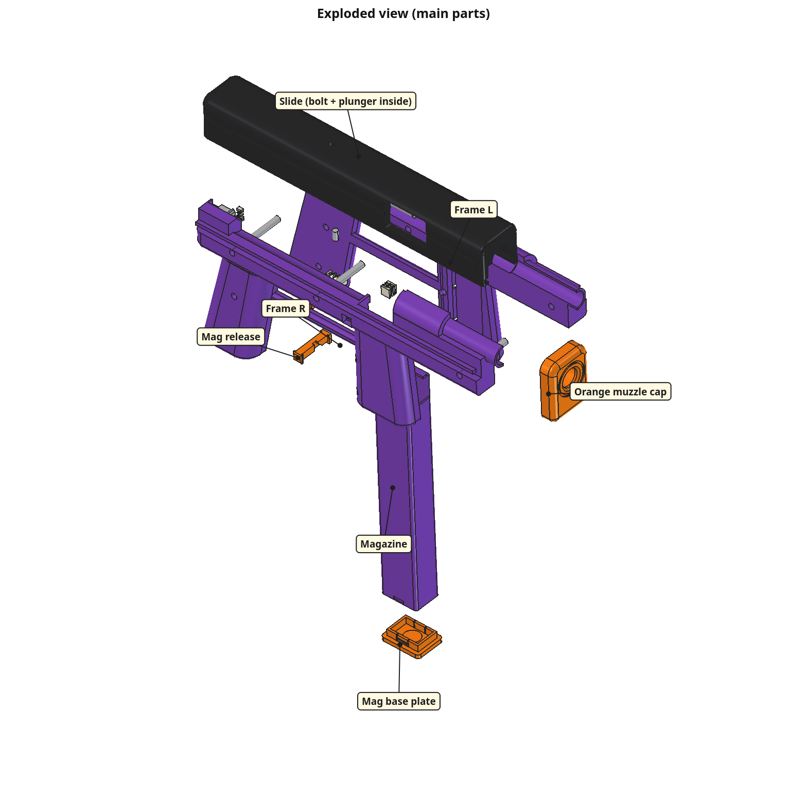

---

## 1. What's in this folder

| Path | What it is |
|---|---|
| `blaster.FCMacro` | The parametric FreeCAD macro. It builds all parts, runs the tests and exports STLs. **This is the source of truth.** |
| `blaster.FCStd` | The saved assembly (slide forward), coloured, for viewing |
| `stl/` | Print-ready STLs, already laid flat in the right orientation |
| `3mf/` | Ready-to-print 3MF plates in 5 PETG/ASA variants (see `3mf/VARIANTS.md`) |
| `tools/export_3mf.py` | Rebuilds the 3MF plates from the model |
| `BUILD.md` | Short build notes and the test summary |
| `README.md` | This guide |
| `docs/images/` | The pictures in this guide, rendered from the CAD |
| `tools/make_manual_images.py` | Re-renders those pictures from the model |
| `versions/` | Earlier saved versions (`v3_front_mag`, `v3.1_mag_release`, `v3.2_extended_mag`, plus an unfinished `v4` experiment) |

**Size:** about 249 × 37 × 189 mm (L × W × H, including the orange button and the extended magazine).
**Printer it was sized for:** Elegoo Centauri Carbon (256 × 256 mm bed, enclosed).

---

## 2. How it works

**Cutaway, slide forward.** The shell is in the chamber and the plunger is resting.

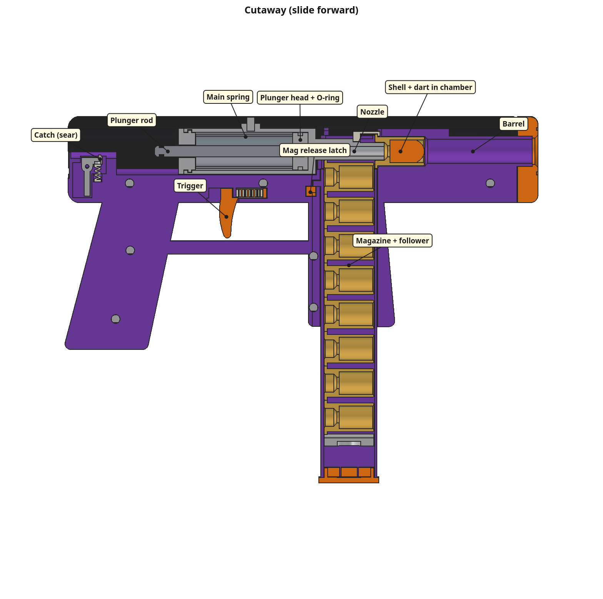

**Cutaway, slide racked back.** The catch tooth is in the rod's notch and the next shell has risen under the lips.

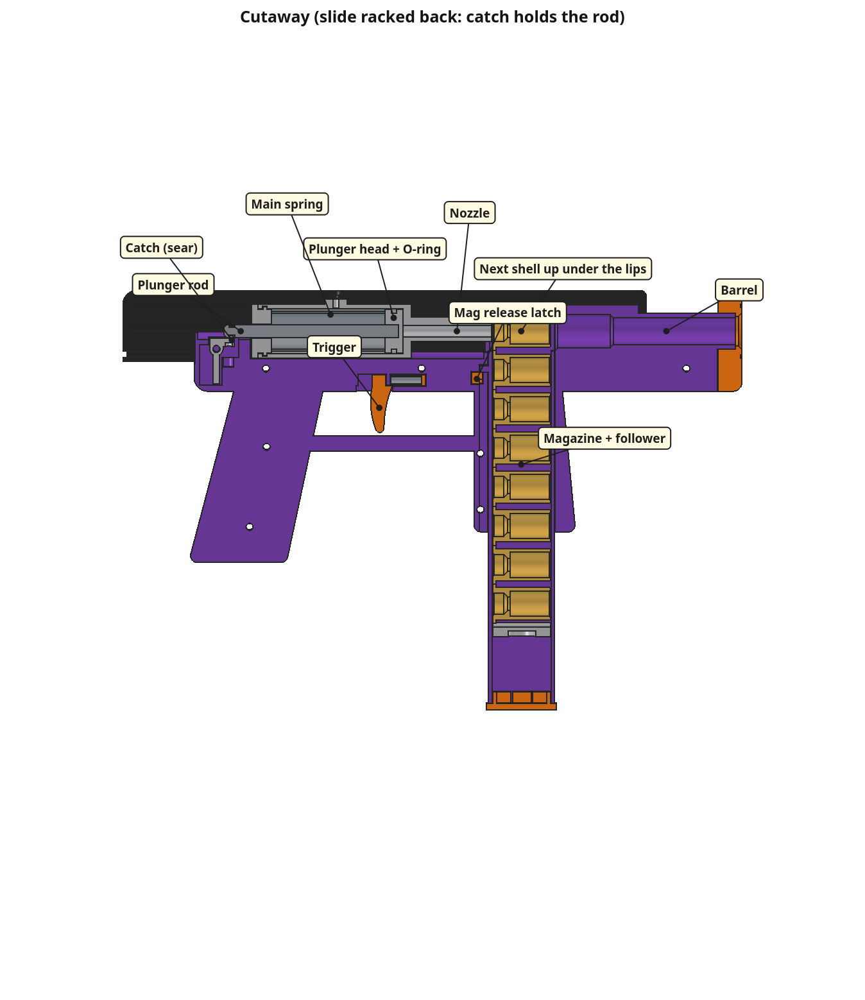

**Main parts:**
- **Bolt:** a plunger tube with a thin nozzle at its front, screwed to the slide so the two move together.
- **Plunger:** a head with an O-ring inside the tube, and a rod that sticks out the back through a cap.
  The rod has a notch near its tail.
- **Catch:** a small spring-loaded lever at the rear of the frame. Its tooth drops into the rod's notch.
- **Trigger:** slides backwards. A bar inside the frame pushes the catch's foot, which drops the tooth.

**One full cycle:**
1. **Pull the slide back 32 mm.** Everything moves back together.
   - The rod's tail rides over the catch, and the catch snaps into the notch.
   - The extractor hook drags the empty shell back until its rim hits the ejector post on the magazine.
     It then flips out of the port on the right.
   - The next shell rises up under the magazine lips.
2. **Push the slide forward.**
   - The catch holds the plunger in place, so the spring compresses.
   - The nozzle pushes the new shell into the chamber and seals into the back of the shell.
**Ejection.** Near the end of the back stroke the shell's rim hits the ejector post, and the extractor
hook swings the shell out of the right-hand port.

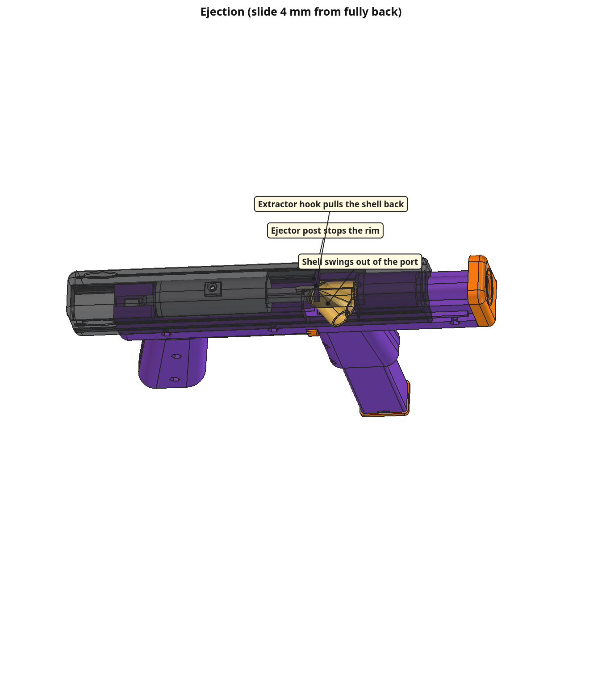

3. **Pull the trigger.** The bar pushes the catch foot back and the tooth drops. The plunger snaps forward,
   and the air goes through the nozzle into the shell and launches the dart.

---

## 3. Before you print: measure your darts

Every bore is calculated from your darts, so measure them first.

1. Measure the **diameter** of 3–4 darts with calipers and average them.
2. Measure the **length** of 3–4 darts.
3. Open `blaster.FCMacro` and set the values near the top:
   ```python
   DART_D   = 11.5   # measured dart diameter (mm)
   DART_L   = 18.0   # measured dart length (mm)
   DART_FIT = -0.1   # shell bore = DART_D + DART_FIT (negative = snug)
   ```
4. Re-export the STLs (see [section 12](#12-changing-the-design-and-re-exporting)).

---

## 4. Print in stages (don't waste filament)

The frame halves and slide use most of the filament, so prove each small sub-system first.

| Stage | Print | What to check | Approx. filament |
|---|---|---|---|
| **1. Dart fit** | `Shell_Chambered` ×2 | The dart pushes in snugly and doesn't fall out when shaken. It should come out with a firm puff of air. | ~5 g |
| **2. Magazine** | `Mag_Body`, `Mag_Follower`, `Mag_Base` + mag spring | Load 8 shells (rim to the rear). The top shell sits flat under both lips. Push the top shell down 3–4 mm and it pops back up. It slides out the front with a light push. | ~35 g |
| **3. Air system** | `Bolt`, `TubeCap`, `Plunger_Head`, `Plunger_Rod`, `Extractor` + O-ring + main spring | The plunger slides smoothly. Cover the nozzle with a finger and push the plunger: you should feel air pressure (a good seal). The cap locks with a quarter turn. | ~40 g |
| **4. Small mechanism** | `Catch`, `Trigger`, `Trigger_Bar`, `Mag_Release` | They fit their springs and move freely by hand. | ~10 g |
| **5. Body** | `Frame_R`, `Frame_L`, `Slide`, `Muzzle_Orange` | Full assembly. | ~250 g |

If a stage fails, tune the parameter (see [section 11](#11-tuning-and-troubleshooting)), re-export and reprint
**only that stage**.

---

## 5. Print settings

**General (PETG):**

| Setting | Value |
|---|---|
| Layer height | 0.2 mm (0.12–0.16 mm for shells) |
| Walls / perimeters | 4 (3 for shells) |
| Top / bottom layers | 5 |
| Infill | 30 % gyroid (100 % for the catch, extractor and plunger rod) |
| Nozzle / bed | ~240 °C / 80 °C (follow your filament's data sheet) |
| Supports | **None.** Every STL is already oriented to print without supports. |
| Brim | 5 mm on the frame halves, the magazine body and the plunger rod |
| Elephant-foot compensation | On (0.15–0.2 mm). The sliding fits only have 0.3 mm clearance. |

**Slide (ASA):** enclosure closed, ~260 °C nozzle / 100 °C bed, no part cooling for the first layers. The
Centauri Carbon's enclosure is enough.

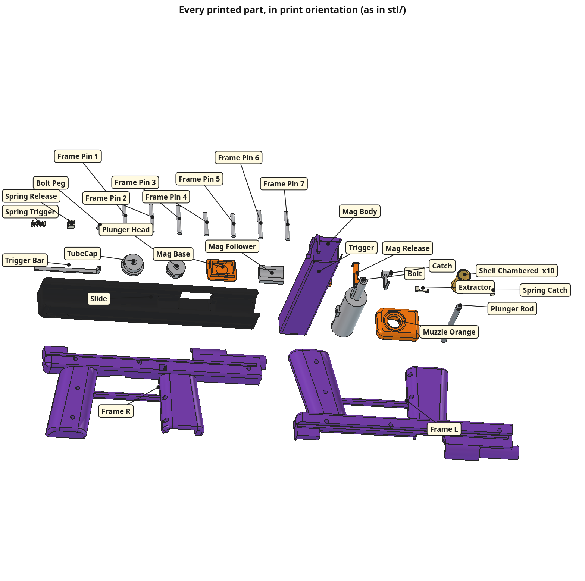

**Don't rotate the STLs.** They are exported flat in the intended orientation.
- The frame halves print with the split face down.
- The slide prints upside down, with its flat top on the bed.

---

### Ready-made 3MF plates (easiest), in 5 material variants

`3mf/` has ready-to-print plates for five PETG/ASA combinations, with one folder per variant. Every part is
laid out on a 256 × 256 bed in its print orientation and kept as a separate object, so you can set brim or
infill per part in the slicer. Plates are grouped by filament and colour, and file names say what to load,
for example `03_ASA_natural.3mf`. The full plate lists and filament estimates are in
[`3mf/VARIANTS.md`](3mf/VARIANTS.md).

| Variant folder | Frame | Slide | Orange accents | Magazine | Internals | Shells | Filament (approx.) |
|---|---|---|---|---|---|---|---|
| `1_petg_main` | PETG | ASA | PETG | PETG | PETG | PETG | PETG ~244 g, ASA ~60 g |
| `2_asa_internals_mag` | PETG | ASA | PETG | **ASA** | **ASA** | PETG | PETG ~212 g, ASA ~88 g |
| `3_asa_outside_petg_inside` | ASA | ASA | ASA | PETG | PETG | PETG | PETG ~47 g, ASA ~226 g |
| `4_all_asa` | ASA | ASA | ASA | ASA | ASA | ASA | ASA ~266 g |
| `5_all_petg` | PETG | PETG | PETG | PETG | PETG | PETG | PETG ~316 g |

"Internals" means the bolt, tube cap, plunger head and rod, catch, trigger bar and extractors.

**Choosing between PETG and ASA:**
- **PETG** is tougher and more flexible, which is better for snap and flex parts like the extractor and mag
  base hooks. It doesn't need an enclosure, slides a bit "grippier", and is a little heavier.
- **ASA** is stiffer, holds its shape in heat and sunlight (for example a hot car), and has slicker surfaces
  for sliding parts. It needs an **enclosure** and shrinks more (~0.5–0.7 %).
  - Turn on the slicer's filament shrinkage compensation for ASA, or the 0.3 mm sliding fits get tight.
  - ASA extractors and mag-base snaps are more brittle. The plates include 3 extractors; if one cracks,
    print it in PETG.

To rebuild all variants after changing the design: `freecadcmd tools/export_3mf.py`.

For the staged test prints in [section 4](#4-print-in-stages-dont-waste-filament), the single STLs in `stl/`
are handier: one shell, one mag and so on.

## 6. Parts list (printed)

| STL | Qty | Material / colour | Orientation | Notes |
|---|---|---|---|---|
| `Frame_R` | 1 | PETG purple | Split face down | 246 mm long. Has the hex nut traps. |
| `Frame_L` | 1 | PETG purple | Split face down | 246 mm long. Has the screw-head counterbores. |
| `Slide` | 1 | ASA black | Top face down | 235 mm long |
| `Muzzle_Orange` | 1 | PETG **orange** | Rear face down | Full-face cap, glued onto the barrel nose |
| `Bolt` | 1 | PETG (natural/grey) | Standing on the tube rear | Tube + nozzle + extractor rib + screw boss |
| `TubeCap` | 1 | PETG | Flange down | Quarter-turn bayonet |
| `Plunger_Head` | 1 | PETG | Flat | O-ring groove |
| `Plunger_Rod` | 1 | PETG | Standing | 100 % infill, brim, slow down the top part |
| `Extractor` | 1 + 2 spares | PETG | On its side | The flexing tuning part |
| `Catch` | 1 | PETG | On its side | 100 % infill |
| `Trigger` | 1 | PETG **orange** | On its side | Curved finger blade |
| `Trigger_Bar` | 1 | PETG | Outer face down | Pegs and glues onto the trigger |
| `Mag_Release` | 1 | PETG **orange** | Top face down | Push-button latch |
| `Mag_Body` | 1 per mag | PETG purple | Upright | 179 mm tall: brim, and slow down the top lips |
| `Mag_Follower` | 1 per mag | PETG | Flat | |
| `Mag_Base` | 1 per mag | PETG **orange** | Flat | Snaps on, no glue |
| `Shell_Chambered` | 10+ | PETG (any) | Rim down | Print extras: 8 for the mag + 1 chambered + spares |

---

## 7. Hardware list (bought)

Everything that isn't printed. The size limits come from the model, so anything within them fits.

### Springs (5 kinds)
| Spring | Qty | Size | Limits from the model |
|---|---|---|---|
| **Main spring** (powers the shot) | 1 | ~18 mm OD, ~1.0 mm wire, ~50 mm free length | OD ≤ 19 mm (the tube bore is 20 mm). ID ≥ 7 mm (the 6 mm rod runs through it). **Solid length ≤ 18 mm**, or the slide won't close. Keep it light. |
| **Mag spring** | 1 per mag | ~11–12 mm OD, **160–170 mm** free length, light | OD ≤ 12 mm. It runs 147 mm long when the mag is empty and 25 mm when full. |
| Catch spring | 1 | ~4 mm OD × 8–10 mm | Sits in a 4.6 mm pocket under the catch |
| Trigger return spring | 1 | ~4 mm OD × ~16 mm | Sits in a 5.2 mm wide window in the trigger slider |
| Mag release spring | 1 | ≤ 3 mm OD × ~12 mm, light | Sits in a 3.2 mm hole in the end of the latch |

### Seal
| Item | Qty | Size | Where |
|---|---|---|---|
| O-ring, NBR (nitrile) | 1 | **16 mm ID × 2 mm** cross-section | Plunger head groove |

### Fasteners
| Item | Qty | Where |
|---|---|---|
| M3 × 30 screw | 5 | 3 in the lower frame, 2 in the rear grip |
| M3 × 25 screw | 2 | Front handle |
| M3 × 6 screw | 1 | Holds the bolt to the slide (from the top) |
| M3 hex nut | 7 | Nut traps in `Frame_R` |
| Steel pin, Ø3 mm × ~20 mm | 1 | Catch pivot. A piece of 3 mm rod or a cut nail works. |

### Consumables
| Item | Use |
|---|---|
| **Silicone grease** | O-ring and sliding parts. **Not petroleum grease**: it swells NBR O-rings. |
| **CA glue** (super glue) | Rod into the plunger head, extractor into its rib, trigger peg, muzzle cap |
| **Soft-tip foam dart refills** | Measure them first and set `DART_D` / `DART_L` (see section 3) |

### Tools
Calipers; a screwdriver or hex key for the M3 screws; flush cutters; drill bits for cleaning holes by hand
(3 mm, 3.2 mm, 6 mm); a needle file; 240–400 grit sandpaper.

### Buying tips
- **Springs:** a compression spring assortment box usually covers the three small springs. Buy the main
  spring and the 160–170 mm mag spring singly. Cutting a longer spring down to length works for the mag
  spring.
- **O-ring:** an NBR O-ring assortment with 2 mm cross-sections lets you try one size up or down if the seal
  is too loose or too tight.
- **Screws:** an M3 screw-and-nut kit covers every screw and nut.

### Where to buy in India: onlyscrews.in (checked 2026-11-25)

This is a partial check. The site rate-limited automated requests after a few pages, so only the items below
were confirmed, with prices from its homepage on that date. Prices and stock change, so re-check before
ordering.

| Covers | Product | Price |
|---|---|---|
| M3 socket-head screws (stainless) | [M3 Allen Socket head SS304 assorted box](https://onlyscrews.in/products/m3-allen-socket-head-ss304-assorted-box) | ₹310 |
| M3 hex nuts (+ M4/M5 nuts, washers) | [Hex Nuts and Washers Assorted Pack M3, M4 & M5 (SS304)](https://onlyscrews.in/products/hex-nuts-and-washers-assorted-screw-pack-m3-m4-m5-ss304) | ₹470 |
| Screws + nuts in one kit | [M3 & M4 3D Printing assorted screw pack](https://onlyscrews.in/products/3d-printing-assorted-screw-pack-allen-socket-heads-hex-nuts-nyloc-nuts-washers-brass-inserts) | ₹1,540 |
| Bigger screw assortment | [Hex (Allen) Socket Head Assorted Screw Pack M3, M4 & M5 (SS304)](https://onlyscrews.in/products/hexallen-socket-head-assorted-screw-pack-ss304) | ₹1,140 |

> **Check the box contents before ordering.** The lengths inside the assortments weren't visible. You need
> **M3 × 30 (5), M3 × 25 (2) and M3 × 6 (1)**. Many M3 assortments stop at 20 mm, so if 30 mm isn't included,
> buy those screws separately.

**Categories the site has but that weren't checked** (they were blocked during the lookup):
- Single socket-head screws (M3 × 30 / × 25 / × 6): [collections/socket-head](https://onlyscrews.in/collections/socket-head)
- Hex nuts: [collections/nuts](https://onlyscrews.in/collections/nuts)
- 3 mm dowel pins for the catch pivot (~20 mm): [collections/hard-dowel-pins](https://onlyscrews.in/collections/hard-dowel-pins)
- Compression springs: [collections/compression-springs](https://onlyscrews.in/collections/compression-springs)

**Probably not on onlyscrews.in:**
- **O-rings:** no O-ring category was found. Get the 16 mm ID × 2 mm NBR O-ring, or an NBR O-ring kit,
  elsewhere.
- **Main spring and mag spring:** the ~18 × 50 mm main spring and the 160–170 mm mag spring are unusual
  sizes. Even if the small springs are available there, these two may need a specialist spring seller.

**Likely cheapest basket:** the ₹310 M3 socket-head box plus the ₹470 nut pack. That works only if the box
has the lengths above.

### The other parts: Amazon.in / Robu.in (checked 2026-11-25)

Prices are as listed on that date and change often, so check the live page, the exact size and the reviews
before buying.

| Part | Best match found | Price | Fit notes |
|---|---|---|---|
| **O-ring 16 ID × 2 mm NBR** | [uxcell NBR O-ring 16 mm ID × 20 mm OD × 2 mm, pack of 50](https://www.amazon.in/uxcell-Nitrile-Rubber-Rings-Sealing/dp/B07F32DWQ5) | ~₹1,086 | **Exact size.** 70A nitrile. |
| O-ring kit (alternative) | [KESARIA 5C NBR O-ring kit, 386 pcs, 30 metric sizes](https://www.amazon.in/KESARIA-NBR-Kit-386-Pcs/dp/B08L6TL3R4) | — | Mostly 2 mm cross-sections, but check that 16 × 2 is in the size list |
| **3 mm pivot pin** | [EasyMech SS304 3 × 20 dowel pin, 10 pcs (Robu.in)](https://robu.in/product/easymech-ss-304-3x20-dowel-pin/) | ~₹123 | **Exact size**, and the cheapest option |
| 3 mm pin (alternative) | [uxcell 3 × 20 mm SS304 dowel pins, 100 pcs](https://www.amazon.in/uxcell-Stainless-Cylindrical-Support-Elements/dp/B07Y5FJBGY) | ~₹3,180 | Exact size but expensive. Clean the hole with a 3 mm bit first. |
| **Small springs** (catch, trigger, mag release) | [CREEYA compression spring kit, 225 pcs, 4–6 mm OD, 10–30 mm](https://www.amazon.in/CREEYA-Compression-Assortment-Different-Stainless/dp/B08KD5Q2P7) | ~₹2,324 | Covers the catch (4 × 8–10) and trigger (4 × 16) springs |
| Small springs (alternative) | [Dianrui 300 pcs, 23 sizes, SS304](https://www.amazon.in/Dianrui-Compression-Assortment-Mechanical-K-P-051-300/dp/B0BVTDP29W) / [IMPRINT 200 pcs (budget)](https://www.amazon.in/IMPRINT-Assortment-Different-Compression-Extension/dp/B0GQQ9ZRFR) | ~₹1,784 / ~₹699 | Check for a **≤ 3 mm OD** spring for the mag release (CREEYA starts at 4 mm) |
| **Mag spring** (~12 OD, 160–170 mm) | 12 mm OD × 1 mm wire × 150 mm, pack of 2 ([Amazon.in search](https://www.amazon.in/compression-spring/s?k=12mm+compression+spring+150mm)) | ~₹150 | Closest light spring. At 150 mm it's slightly short, so the last shell in a nearly empty mag feeds weakly. The 200 mm × 1.5–3 mm wire versions (~₹3,000) are too stiff. |
| **Main spring** (~18 OD × 1.0 wire × 50 mm, solid ≤ 18 mm) | **No exact match found** | — | See the warning below |
| Silicone grease | [ZDBB silicone O-ring grease, 1 oz](https://www.amazon.in/ZDBB-Silicone-Lubricant-Cartridges-Pressure/dp/B0DMSSFML2) or [VAC PAC O-ring silicone grease, 100 g](https://www.amazon.in/Ring-Silicone-Grease-Performance-Lubricant/dp/B0CL2CPS9N) | — / ~₹1,099 | Silicone grease is fine on NBR O-rings. **Don't use petroleum grease.** |
| **Soft-tip darts** | [Toy Cloud sticky-head foam darts, 40 / 200 / 300 pcs](https://www.amazon.in/Toy-Cloud-Bullet-Refill-N-Stike/dp/B09HCQ8878) | ~₹250 (40) | Listed as **7.2 × 1.2 cm**, so set `DART_D = 12.0`, `DART_L = 72` after measuring |
| Darts (alternative) | [Storio soft foam refill darts, 50 pcs](https://www.amazon.in/Storio-Foam-Darts-Bullets-50/dp/B0CP2GCW83) | ~₹179 | No diameter listed: measure before printing shells |
| CA glue | Any super glue (e.g. Fevikwik) | — | Local shop |

> **Main spring warning.** Keep the shot indoor-safe. The closest listings are stiffer than the design spring:
> - [Edinstry 1.5 × 18 × 50 mm](https://www.amazon.in/Diameter-Stainless-Extended-Compressed-Springs/dp/B09FFB3CC9)
>   has 1.5 mm wire and is roughly 5× stiffer. **Don't use it.**
> - [IMPRINT 18 mm OD × 1.2 mm wire × 100 mm](https://www.amazon.in/IMPRINT-Compression-Spring-1-2mm-100mm/dp/B0H6V9Y782)
>   is about 2× stiffer, and cutting it shorter makes it stiffer still.
>
> Better: buy a **1.0 mm (or 0.8 mm) wire, 18 mm OD** spring from a spring maker. Or use the IMPRINT spring
> uncut only if its solid length fits. Spring space: 51 mm at rest, 19 mm cocked, so the solid length must be
> ≤ 18 mm. Never go stiffer than the design spring.

> **Darts are longer than the default.** The common Indian refills are ~72 mm long, but the model was set up
> for 18 mm stubby darts. Measure yours and set `DART_D` / `DART_L`, then re-export before printing.
> A 72 mm dart sticks out of the 26 mm shell and needs a longer barrel; ask to have the barrel and shell
> resized for long darts.

## 8. Cleaning up the prints

1. **Remove brims** and any stringing.
2. **Clean the holes:**
   - Run a 3 mm drill bit by hand through the pivot-pin holes.
   - Use a 3.2 mm bit for the screw holes.
   - Use a 6 mm bit for the rod hole in the cap.
3. **Sliding surfaces:** lightly sand these until they slide without wobble. Don't overdo it:
   - the slide rails and their grooves in the slide
   - the trigger slider and its channel
   - the mag release bar
   - the magazine's outside
4. **Chamber and shell bores:** if a shell won't drop into the chamber, sand the chamber mouth and check for
   an elephant foot on the shell rim.
5. **Test-fit before gluing anything.**

---

## 9. Assembly

Work on a clean table and keep the screws in a tray. Lay `Frame_R` split face up. It is the half with the
nut traps.

### 9.1 Plunger
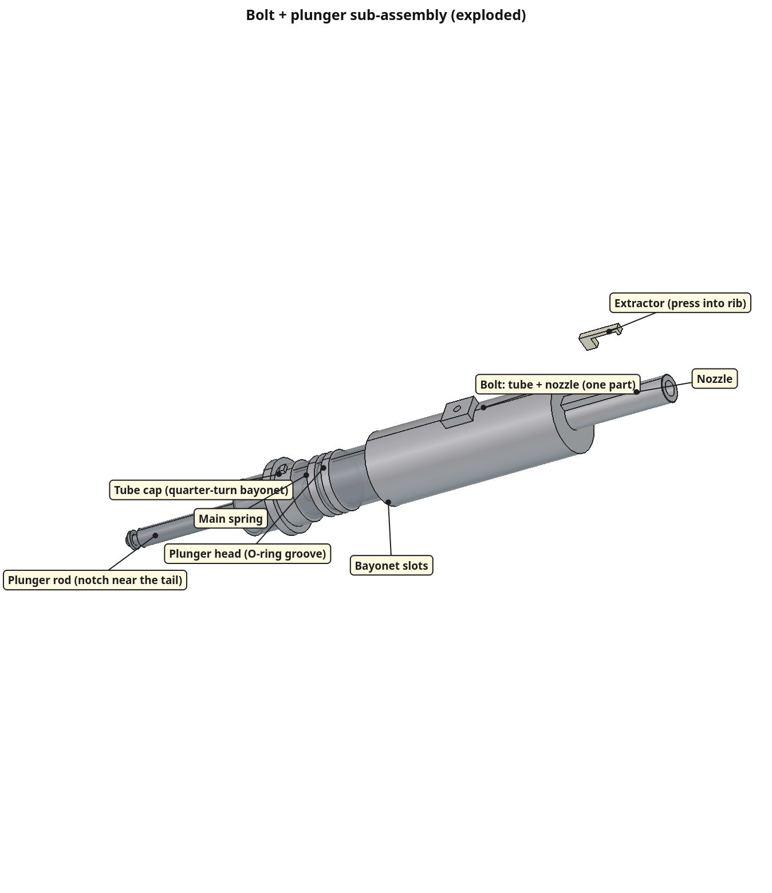

1. Press the front (spigot) end of `Plunger_Rod` into the socket of `Plunger_Head`. Put a drop of CA on it
   first, keep it straight, and let it cure.
2. Roll the O-ring into the head's groove. Add a thin film of silicone grease.

### 9.2 Bolt (tube + nozzle)
1. Slide the plunger into the back of the `Bolt` tube, **head first**, until it reaches the front wall.
2. Drop in the **main spring** behind the head.
3. Thread `TubeCap` over the rod's tail. Line up its two lugs with the two slots at the tube's rear and push
   it in against the spring. **Turn it a quarter turn** to lock.
4. Press the `Extractor` base into the pocket on top of the nozzle rib, with the hook at the front pointing
   down. Add a drop of CA.
5. Check that the plunger pulls back smoothly by the rod and snaps forward.

### 9.3 Slide
1. Turn the `Slide` upside down. Lay the bolt into it from below, with the screw boss into its pocket.
2. Fix it with the **M3 × 6** screw from the top of the slide.

### 9.4 Catch (in `Frame_R`)
Start with `Frame_R` lying split face up:

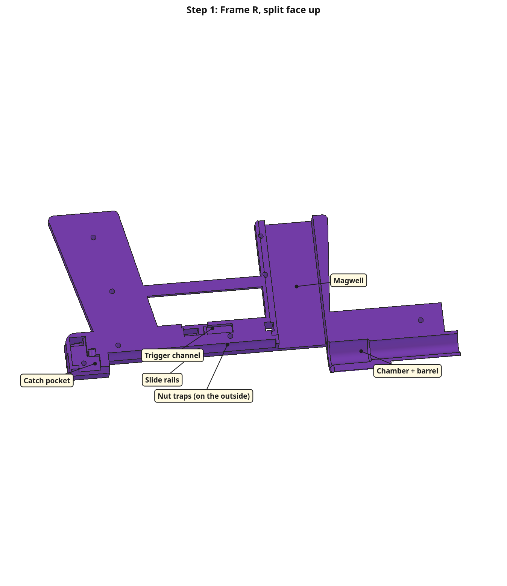

Then fit the catch and the trigger. This close-up has the frame made see-through:

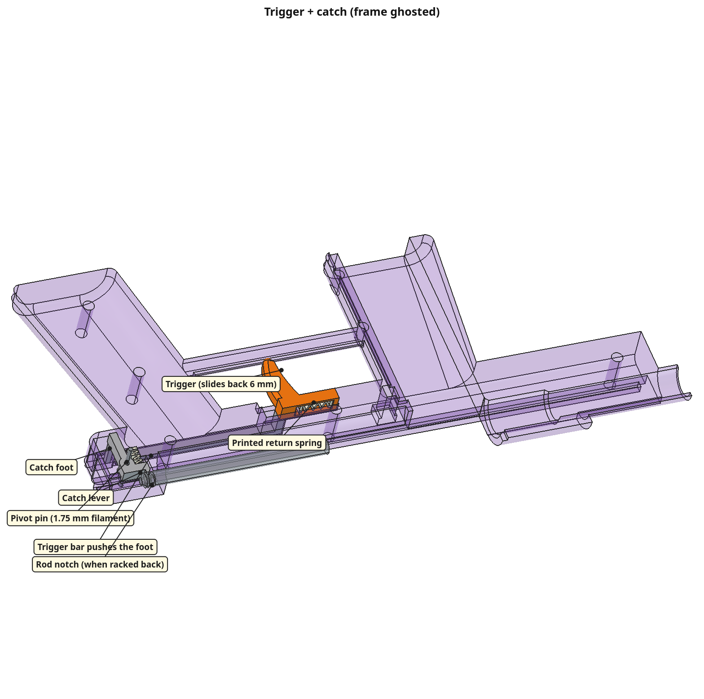

1. Drop the **catch spring** into the pocket under the catch slot at the rear.
2. Place the `Catch` lever: tooth up and forward, foot down and outward.
3. Push the **Ø3 pin** through the pivot hole.
4. Press the tooth down with a finger. It should spring back up.

### 9.5 Trigger (in `Frame_R`)
1. Push the peg of `Trigger_Bar` into the hole in the side of `Trigger`. Add a drop of CA and keep them square.
2. Put the **trigger return spring** in the trigger's window, in front of the small post in the frame.
3. Lay the trigger and bar into their channels. The bar's rear end must sit just in front of the catch's foot.
4. Pull the trigger. The bar should push the foot back and the catch tooth should drop. Let go and it returns.

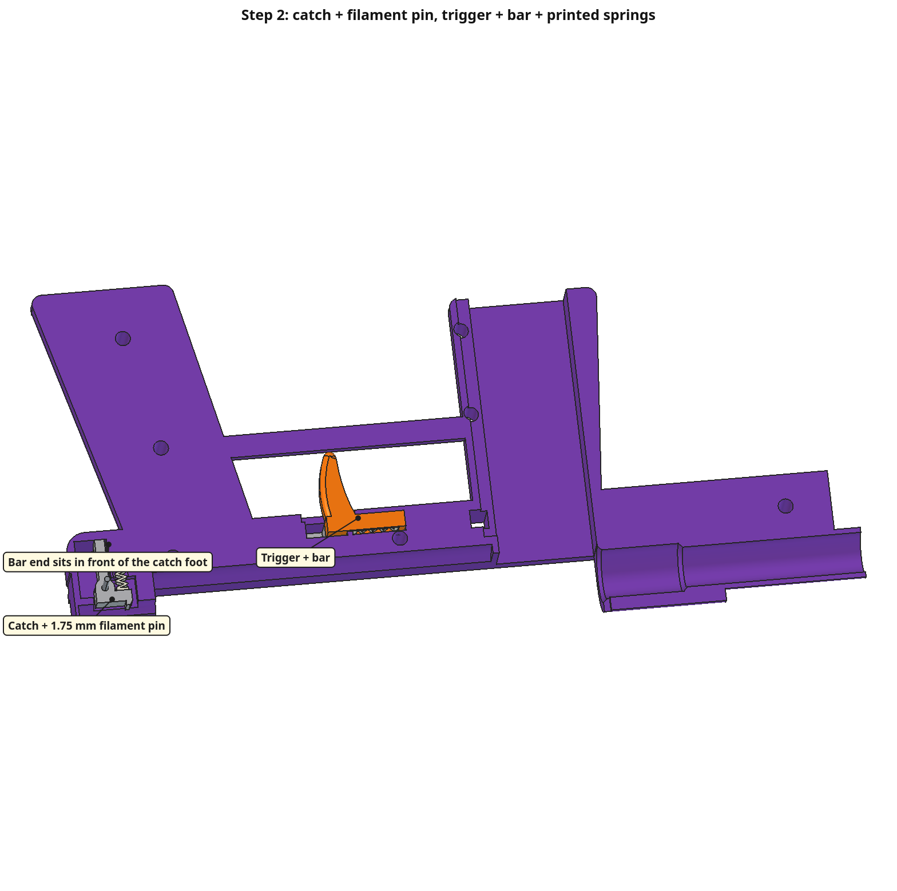

### 9.6 Mag release (in `Frame_R`)
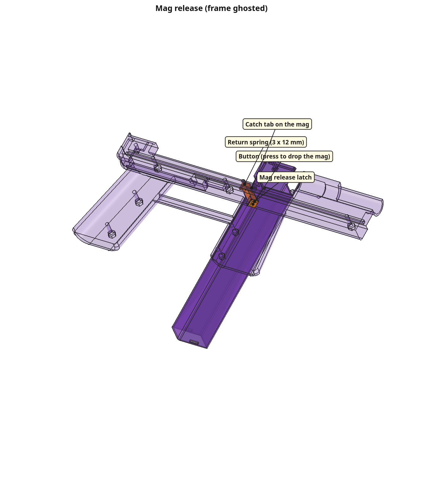

1. Drop the **mag release spring** into the hole in the inner end of `Mag_Release`.
2. Lay the latch in its channel behind the magwell, with the button out through the right side of the frame.
3. Press the button. It should move about 3.5 mm and spring back.

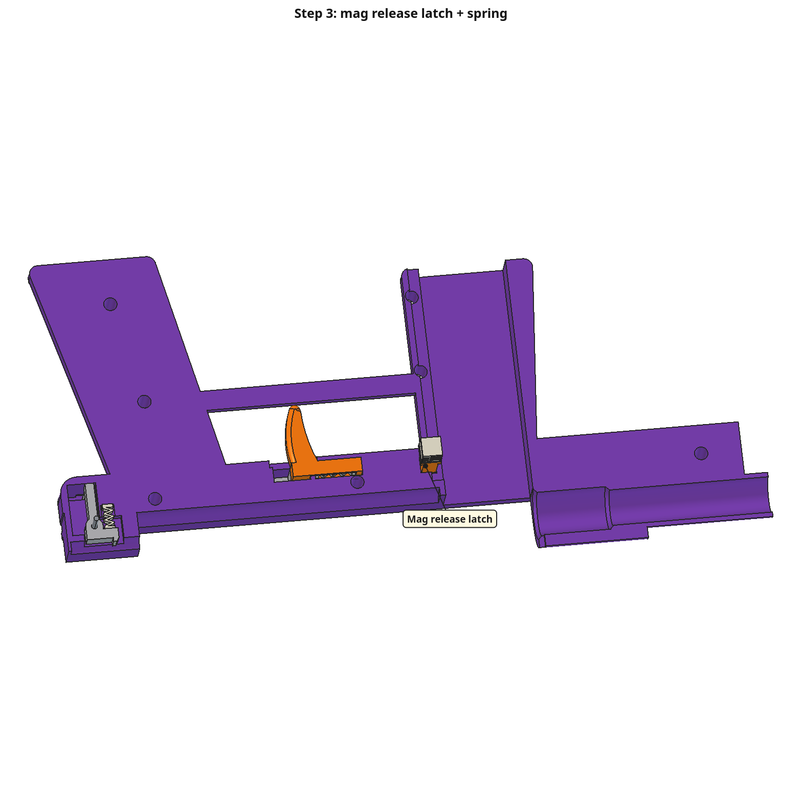

### 9.7 Close the frame
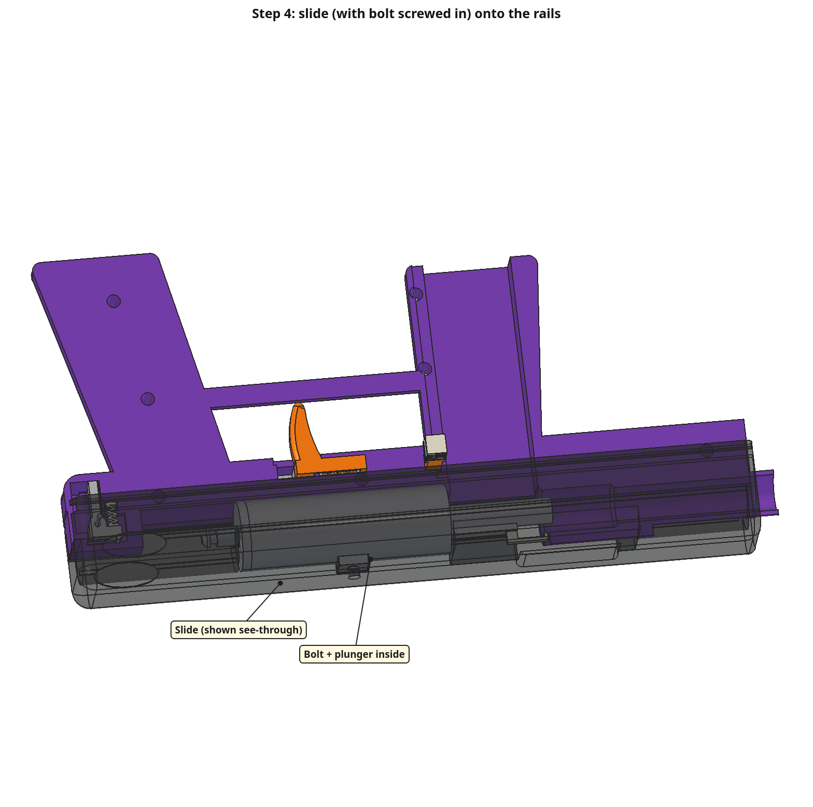

1. Set the slide assembly onto `Frame_R`'s rails.
2. Check the following, then push the slide fully forward:
   - The nozzle points into the chamber.
   - The plunger rod's tail sits over the catch.
3. Put the 7 **hex nuts** into the nut traps in `Frame_R`. A dab of glue stops them falling out.
4. Place `Frame_L` on top and fit the screws:
   - **M3 × 30** in the lower frame and the rear grip
   - **M3 × 25** in the front handle

   Tighten evenly and **don't overtighten**. The slide must still slide.
5. Rack the slide a few times by hand. It should run smoothly the whole 32 mm.

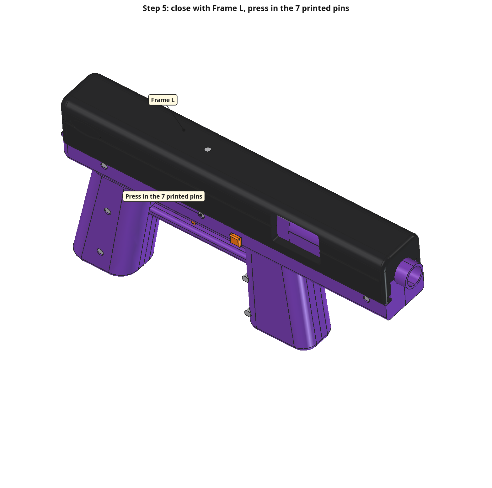

### 9.8 Muzzle cap
Glue `Muzzle_Orange` onto the barrel nose in front of the slide. Make sure the bore lines up.

### 9.9 Magazine
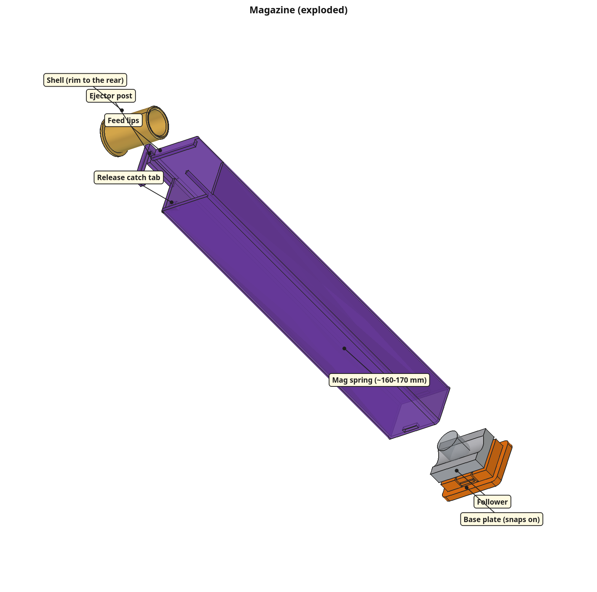

1. Put the mag spring into `Mag_Body` from the bottom, with the `Mag_Follower` on top (saddle up).
2. Press `Mag_Base` on until both snap hooks click.
3. **Load shells:** a dart goes into each shell first. Push shells down under the lips from the front, **rim
   to the rear**, one at a time, up to 8.
4. Push the mag up into the front handle until the latch clicks under the tab on the mag's back.

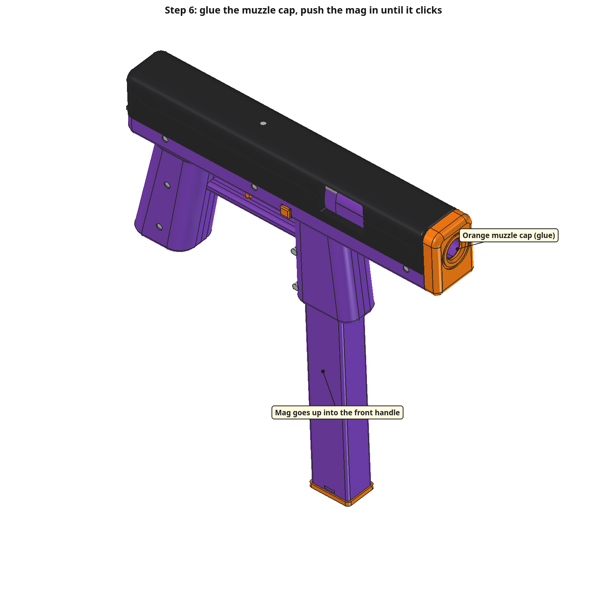

---

## 10. Using it

1. **Load:** insert a full mag until it clicks.
2. **Rack:** pull the slide **fully** back, then push it **fully** forward. The first shell is now chambered
   and the spring is cocked.
3. **Fire:** pull the trigger.
4. **Next shot:** rack again. The empty shell ejects to the right and the next one chambers.
5. **Unload:** press the orange button on the right side above the front handle, and the mag drops out. Rack
   the slide once to eject a chambered shell. Point the blaster at the floor and pull the trigger to release
   a cocked spring.

**Picking up shells:** they eject to the right, so shoot over a clear floor or a box.

**Storage:** don't leave it cocked. Store it with the spring released.

---

## 11. Tuning and troubleshooting

All values are parameters at the top of `blaster.FCMacro`. Change, re-export, and reprint only the affected
part.

| Problem | Likely cause | Fix |
|---|---|---|
| Dart falls out of the shell | Shell bore too big | `DART_FIT` more negative (−0.2) → reprint shells |
| Dart sticks / weak shot | Shell bore too tight | `DART_FIT` −0.05 or 0 |
| Weak shot, air hiss | Poor plunger seal | Fresh grease; snugger O-ring (or a 2.5 mm cross-section) |
| Plunger very stiff | O-ring too tight | Thinner O-ring / more grease |
| Too strong for indoors | Spring too stiff | Lighter spring (wire ≤ 1.0 mm). **Never go stronger.** |
| Spring coil-binds (slide won't close) | Spring solid length > 18 mm | Use a spring with fewer coils / thinner wire |
| Shell not chambered | Mag spring too weak, or lips too tight | Stronger mag spring, sand the lips lightly |
| Top shell hard to strip (full mag) | Mag spring too strong when full | Lighter or longer mag spring |
| Extractor won't snap over the rim | Arm too stiff | `EXTRACTOR_T` 1.0, or a softer PETG |
| Extractor loses the shell | Arm too soft | `EXTRACTOR_T` 1.4 |
| Shell doesn't eject / ejects weakly | Ejector timing | Adjust `EJECT_REMAIN` (default 4 mm of slide travel left when the rim hits the post) |
| Catch doesn't hold | Notch too shallow / worn | `NOTCH_DEPTH` + 0.2 (rod core stays ≥ 3.6 mm) |
| Trigger won't fire | Bar doesn't reach the foot | Reduce `FOOT_GAP` |
| Mag won't latch | Latch sticky / spring weak | Sand the latch channel; stronger release spring |
| Mag won't drop when pressed | Button travel short | Check the latch slides the full 3.5 mm; clean the channel |
| Slide sticks | Tight rails / elephant foot | Sand the rail ribs; raise `CLR` to 0.35 and reprint |

---

## 12. Changing the design and re-exporting

You need FreeCAD 1.0 or newer.

**In the GUI:** Macro → Macros… → select `blaster.FCMacro` → Execute. The coloured assembly appears in a new
document called `Blaster`.

**Headless (terminal):**
```bash
freecadcmd blaster.FCMacro
```

**Export STLs:** set `EXPORT_STL = True` at the top of the macro and run it again. The files are written to
`stl/`, already oriented for printing.

**View the slide racked back or the spring cocked:** set `SLIDE_POS = 1.0` or `COCKED = True`.

**Useful parameters:**

| Parameter | Default | What it changes |
|---|---|---|
| `DART_D`, `DART_L`, `DART_FIT` | 11.5, 18, −0.1 | Dart fit (shell, chamber and barrel sizes follow) |
| `MAG_CAPACITY` | 8 | Shells per mag (mag length follows) |
| `HANDLE_CAPACITY` | 4 | Length of the front handle |
| `CLR` | 0.3 | Sliding clearance everywhere |
| `STROKE` | 32 | Slide travel (= shell length + 6) |
| `SPRING_SPACE`, `MAIN_SPRING_SOLID` | 51, 18 | Main spring pocket / its solid length |
| `EXTRACTOR_T` | 1.2 | Extractor stiffness |
| `EJECT_REMAIN` | 4 | Ejector timing |
| `REL_T` | 3.5 | Mag release button travel |

**Re-render the pictures in this guide** (in the FreeCAD GUI Python console):
```python
exec(open('tools/make_manual_images.py').read()); make_all()
```

**Run the checks after any change:**

```python
# in the FreeCAD Python console
import runpy
ns = runpy.run_path('blaster.FCMacro', run_name='x')
print(ns['run_tests']())                       # static collisions, slide forward and back
for r in ns['mech_tests'](): print(r)          # shell path, ejection, feed, catch, mag release
for r in ns['cycle_sim'](): print(r)           # full firing cycle, step by step
ns['build_all'](); print(ns['print_checks']()) # every part flat and fits the bed
```

Every line should say `True` / `PASS` before you print.

---

## 13. What the built-in simulations check (and what they don't)

**Checked (geometry and motion), all passing for the current version:**
- Every part is a valid solid, with **zero unintended overlap** with the slide forward and back. Only the
  press fits are allowed to overlap.
- **Shell path:**
  - The shell extracts cleanly.
  - It meets the ejector with 4 mm of slide travel left.
  - It swings out of the right port, clear of everything.
  - The next shell feeds into the chamber.
- **Fire cycle (step by step):**
  - Rack back: the rod pushes the catch down about 9°.
  - Catch engages.
  - Push forward: the spring compresses to 19 mm, above its 18 mm solid length.
  - The trigger releases at 4 mm of travel.
  - The plunger runs the full stroke clear of everything.
- **Mag release:**
  - It holds the mag.
  - The button moves freely.
  - The mag drops out clear when pressed.
  - A mag pushed in shoves the latch aside (3.25 mm of 3.5 mm) and it snaps back.
- **Printing:** every part lies flat on the bed with real contact area and fits a 256 mm bed. Every STL is
  a closed mesh.

**Not checked (only a physical test will tell):**
- **Forces:**
  - spring strengths
  - whether the catch holds against the spring
  - trigger pull weight
  - how hard the full mag pushes on the top shell
- **Air seal and power:**
  - O-ring fit
  - how far the dart flies

  The plunger moves only ~1.2× the air volume of the shell and barrel, which is a modest margin.
- **Print accuracy:** shrinkage, elephant foot and layer lines can eat up the 0.3 mm clearances.
- **Ejection dynamics:** the ejection check is a sweep of positions, not a physics simulation. Expect to
  fine-tune `EJECT_REMAIN` and the extractor after the first assembled test.

That's why section 4 prints in stages.
